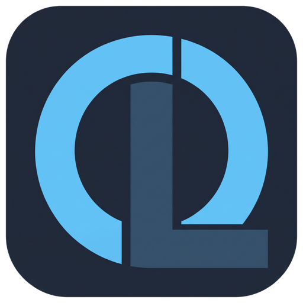

<div align="center">
  

  # One Launcher

  **All of your PC and Mac games in one place — Steam, GOG, Epic Games, Xbox / PC Game Pass, and local installs.**

  [](https://github.com/Space-Cadet0/One-Launcher/releases/tag/v0.2.7)
  [](#download--install)
  [](#download--install)
</div>

---

If your games are split across Steam, GOG, Epic, Xbox / PC Game Pass, and a handful of standalone folders, it gets annoying fast trying to remember where you own something or which launcher actually has it installed.

One Launcher pulls your whole collection into a single desktop app for **macOS (Apple Silicon)** and **Windows 10/11**. It tracks what you own, merges duplicates across stores, downloads artwork, critic scores, and HowLongToBeat times, and lets you launch Mac-native games, Windows games on PC, or Windows games on Mac through CrossOver, Apple Game Porting Toolkit, or Wine.

---

## Download & Install

Grab the latest installers from the **[v0.2.7 Release page](https://github.com/Space-Cadet0/One-Launcher/releases/tag/v0.2.7)**.

### macOS (Apple Silicon, macOS 13 or newer)
1. Download **`One Launcher-0.2.7-arm64.dmg`** from the [v0.2.7 release](https://github.com/Space-Cadet0/One-Launcher/releases/tag/v0.2.7).
2. Open the disk image and drag **One Launcher** into your **Applications** folder.
3. Because the app isn't notarized with an Apple Developer subscription yet, macOS Gatekeeper may warn you on first launch. Right-click **One Launcher** in Applications and choose **Open**, or run this in Terminal:
   ```bash
   xattr -cr "/Applications/One Launcher.app"
   ```

### Windows (Windows 10 / 11, 64-bit)
- Download and run **`One Launcher Setup 0.2.7.exe`** from the [v0.2.7 release](https://github.com/Space-Cadet0/One-Launcher/releases/tag/v0.2.7).
- If you ever want a clean removal later, **`One Launcher Full Uninstaller.exe`** is also attached to the same release.

When you open One Launcher for the first time, a 5-step Setup Wizard walks you through signing in to your store accounts and checking your compatibility runners (on Mac) or system prerequisites (on Windows). You can re-open it anytime from the top-left menu.

---

## A Look Inside

### Your whole library on one screen

Filter by storefront, readiness, genre, critic score, or release era, and organize your games into custom collections in the sidebar.

### Game pages with storefront switching

Each game gets its own page with trailers, screenshots, playtime, Metacritic/OpenCritic scores, and HowLongToBeat estimates. If you own the same title in more than one place, One Launcher combines them into a single page and puts a store picker right next to the Play or Install button.

### Store accounts, Game Pass sync modes, and offline caching

Sign in directly to Steam, GOG.com, Epic Games, and Xbox Live using their official sign-in pages—no extra launchers need to stay open in the background. For Xbox / PC Game Pass, you can choose whether to show your full Game Pass catalog, only games you've played or installed, or just permanent purchases.

### Playing Windows games on Mac

Mac players can tweak CrossOver, CrossOver Preview (`arm64 / FEX`), Apple Game Porting Toolkit, or Wine settings per game: pick D3DMetal or DXMT, turn on MetalFX DLSS upscaling, cap frame rates to keep fans quiet, enable Retina sharpness, and toggle fullscreen or aspect-ratio scaling on the fly with `Ctrl+Option+F` and `Ctrl+Option+A`.

### Achievements across stores

Browse unlocked and locked achievements with global rarity percentages and unlock dates. Descriptions for secret achievements stay blurred until you click them, so you won't accidentally spoil a story beat.

---

## What It Does

### Connects your storefronts without getting in the way
One Launcher brings together **Steam**, **GOG.com**, **Epic Games Store**, **Xbox / PC Game Pass**, and **custom local games** (both native `.app` bundles on Mac and Windows `.exe` folders). It automatically scans your drives and compatibility bottles for games you already have installed, filters out uninstallers and crash reporters, and merges duplicate entries when you own the same game on two stores.

*Note on Xbox Game Pass:* Direct Xbox and PC Game Pass games are supported on both Windows and Mac, including achievements and cloud saves. However, **chained launchers for Xbox Game Pass games (such as EA games launched through the EA App) are not yet implemented.**

### Makes Windows games behave better on Mac
If you game on Apple Silicon, One Launcher works alongside **CrossOver**, **CrossOver Preview** (both `x86_64` and `arm64 / FEX`), **Apple Game Porting Toolkit**, and **Wine**. It detects your installed runners and bottles, lets you pick the graphics backend (`D3DMetal`, `DXMT`, `DXVK`, or `WineD3D`) per game, exposes MetalFX DLSS where supported, and fixes common fullscreen headaches on older and newer Windows games alike. Live shortcuts let you switch between fullscreen and windowed (`Ctrl+Option+F`) or cycle aspect ratios like 4:3 pillarbox and integer scaling (`Ctrl+Option+A`) while a game is running.

### Keeps downloads, saves, and offline browsing tidy
You can queue game installs directly from One Launcher, track extraction and verification progress, and let downloads pause automatically the moment you start playing something else. Before and after a session, One Launcher keeps rolling local backups of your saves alongside storefront cloud sync. While you're in a game, In-Game Hibernation frees up artwork and video memory so the launcher stays out of your way, and the Offline Library Vault caches your catalog and covers locally so your library still loads cleanly on a plane or train.

### Fixes messy matches when local folders look weird
Added a DRM-free game or an old installer whose folder name didn't match right away? Open the 4-step Fix Match wizard to search Steam, GOG, Epic, and IGDB at once, swap the cover art or hero banner, tweak the title or description, and preview the card before saving.

---

## Good to Know (Current Limitations)

- **Chained launchers for Xbox Game Pass games (e.g., EA) are not yet implemented.** Direct Game Pass titles work, while Game Pass games that hand off to a third-party publisher client like the EA App aren't supported yet.
- Games that require Windows kernel-level anti-cheat (such as Riot Vanguard) cannot run inside macOS compatibility layers and require native Windows.

---

<details>
<summary>Building from Source (For Developers)</summary>

Requires **Node.js 22+**, **npm**, and **Zig 0.13.0** (for building the Xbox GDK bridge DLLs from C source).

```bash
git clone https://github.com/Space-Cadet0/One-Launcher.git
cd One-Launcher

npm install
npm run build:xbox-bridge
npm run build:display-scaler
npm run build:macos-helpers   # macOS only

# Run renderer + Electron desktop shell in separate terminals
npm run dev
npm run desktop
```

To package release installers locally:
```bash
npm run dist:mac   # macOS arm64 DMG
npm run build:win  # Windows x64 installer & uninstaller
```

</details>

---

## License

Released under the [MIT License](LICENSE).
