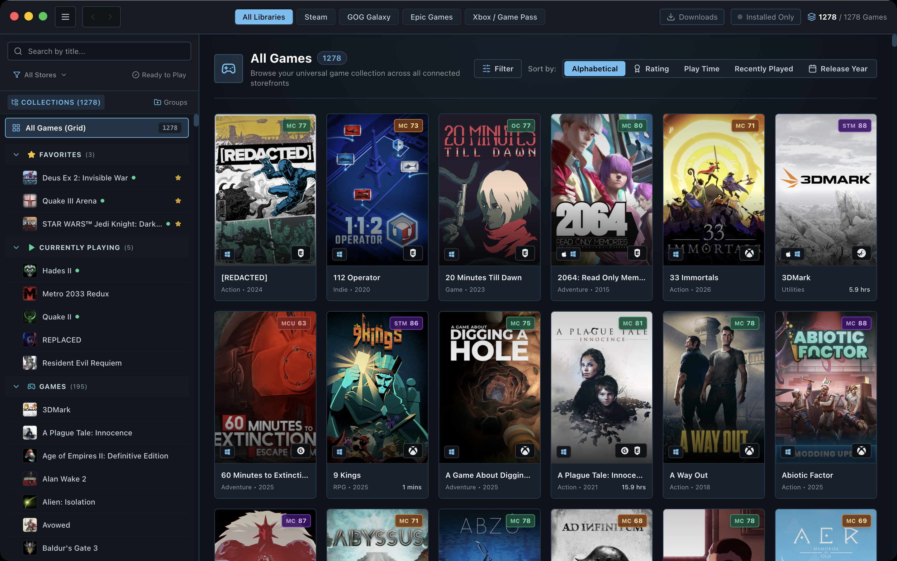
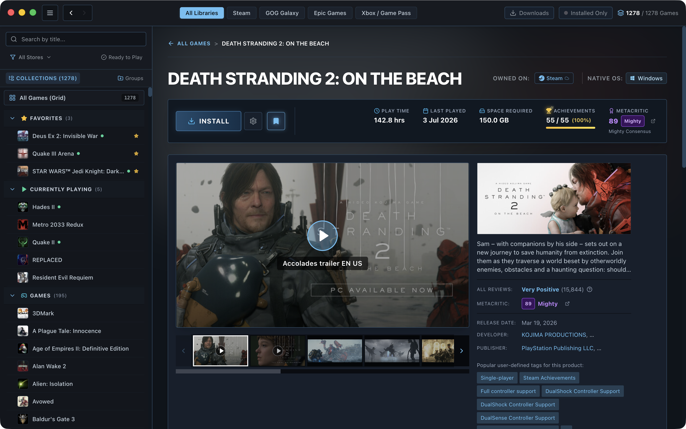
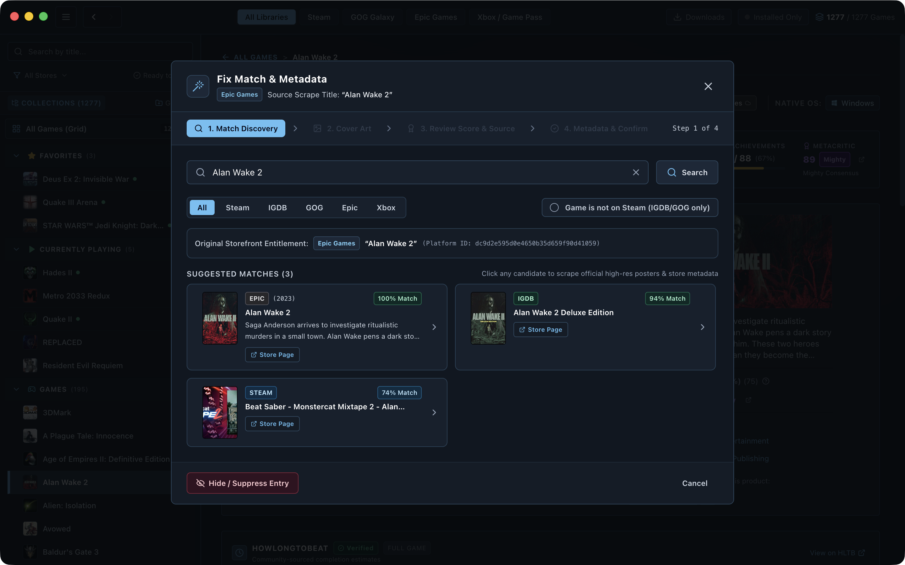
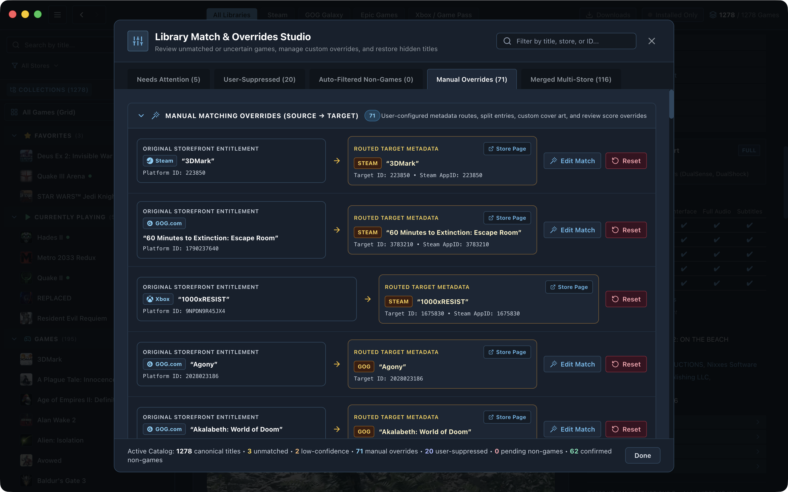

<div align="center">
  

  # One Launcher

  **Your PC and Mac games on one shelf: Steam, GOG, Epic Games, Xbox / PC Game Pass, and standalone installs.**

  [](https://github.com/Space-Cadet0/One-Launcher/releases/tag/v0.2.7)
  [](#download--install)
  [](#download--install)
</div>

---

When your games live across Steam, GOG, Epic, Xbox / PC Game Pass, and a handful of local folders, half the battle is just remembering where you bought something and whether it is actually installed.

One Launcher pulls everything into one desktop app for **macOS (Apple Silicon)** and **Windows 10/11**. It tracks what you own across storefronts, combines duplicate copies onto a single page, gathers trailers, critic scores, and HowLongToBeat times, and lets you launch Mac-native games, Windows games on PC, or Windows games on Mac via CrossOver, Apple Game Porting Toolkit, or Wine.

---

## Download & Install

Grab the latest installers from the **[v0.2.7 Release page](https://github.com/Space-Cadet0/One-Launcher/releases/tag/v0.2.7)**. Once installed, an in-app update checker notifies you whenever a newer release ships and lets you jump straight to the installer.

### macOS (Apple Silicon, macOS 13 or newer)
1. Download **`One Launcher-0.2.7-arm64.dmg`** from the [v0.2.7 release](https://github.com/Space-Cadet0/One-Launcher/releases/tag/v0.2.7).
2. Open the disk image and drag **One Launcher** into your **Applications** folder.
3. Because the app isn't notarized with an Apple Developer subscription yet, macOS Gatekeeper may warn you on first launch. Right-click **One Launcher** in Applications and choose **Open**, or run this in Terminal:
   ```bash
   xattr -cr "/Applications/One Launcher.app"
   ```

### Windows (Windows 10 / 11, 64-bit)
- Download and run **`One Launcher Setup 0.2.7.exe`** from the [v0.2.7 release](https://github.com/Space-Cadet0/One-Launcher/releases/tag/v0.2.7).
- If you ever want a clean removal later, **`One Launcher Full Uninstaller.exe`** is attached to the same release so nothing is left behind.

On first launch, a 5-step Setup Wizard helps you connect your store accounts and verify your Mac compatibility tools (CrossOver, Apple Game Porting Toolkit, or Wine) or Windows runtime prerequisites. An ongoing health check flags any missing tools or broken bottle settings in the menu bar so you can re-open the wizard and repair them anytime.

---

## A Look Inside

### Your whole library on one screen

Browse every title in a cover grid, switch storefronts or installed-only views from the top bar, narrow down with 6 filter categories (OS compatibility, critic/player ratings, genres, game features like co-op or HDR, release era, and developers/publishers), sort how you like, and organize games into custom sidebar collections with 24 folder icons.

### Game pages built for actually deciding what to play

Every game gets a dedicated page with playtime tracking, achievement progress, Critic and Steam consensus badges, trailers, and a storefront switcher right next to Play or Install whenever you own the same title on multiple stores.

### Store descriptions, clips, controller support, and languages

Scroll past the media reel for the full store description complete with auto-playing video clips, controller and DualSense feature flags, supported audio/subtitle languages, and release metadata.

### HowLongToBeat times and critic reviews in one spot

Live HowLongToBeat cards show Main Story, Main + Sides, Completionist, and All Styles estimates right above Metacritic, OpenCritic, and Steam review breakdowns so you know what you are getting into before you hit download.

### Store accounts, Game Pass sync modes, and offline caching

Sign in directly to Steam, GOG.com, Epic Games, and Xbox Live through their official login pages, without leaving four separate store launchers open in the background. For Xbox / PC Game Pass, you can choose whether to sync your full Game Pass catalog, only games you have played or installed, or strictly permanent purchases.

### Playing Windows games on Mac

For Windows titles running on a Mac, each game keeps its own graphics and display settings: pick a translation backend (`D3DMetal`, `DXMT`, `DXVK`, or `WineD3D`), turn on MetalFX DLSS or Spatial upscaling, enable HUD overlays (Apple Metal HUD or DXVK / DXMT HUD with live FPS telemetry), cap frame rates to keep fans quiet, switch on Retina 192 DPI mode for sharp menus and text, and tune fullscreen or aspect-ratio scaling.

### Achievements across stores

Inspect unlocked and remaining achievements from Steam, Epic, GOG, and Xbox in one place with unlock dates and global rarity percentages. Secret achievement descriptions stay hidden behind a Reveal Spoiler toggle so story moments don't get spoiled.

### Fix Match wizard when local folders get weird

If an old DRM-free install, bottle `.exe`, or ambiguously named folder pulls the wrong cover, the 4-step **Fix Match & Metadata** wizard searches Steam, IGDB, GOG, Epic, and Xbox together, lets you swap 2:3 cover poster artwork, pick your preferred review source, and edit metadata before applying anything.

### Library Match & Overrides Studio for auditing your catalog

Open **Library Match & Overrides Studio** from the top-left menu to review auto-matched titles, track down unmatched installs, and manage every manual override in one table.

---

## How Everything Fits Together

### Multi-storefront sync without clutter
One Launcher connects to **Steam**, **GOG.com**, **Epic Games Store**, **Xbox / PC Game Pass**, and **local installs** (both macOS `.app` bundles and Windows `.exe` directories). Its scanner sweeps your drives and CrossOver or Wine bottles for already-installed games while skipping stray uninstallers and crash reporters.

*Note on Xbox Game Pass:* Direct Xbox and PC Game Pass games are supported on both Windows and Mac, including achievements and cloud saves. However, **chained launchers for Xbox Game Pass games (such as EA games launched through the EA App) are not yet implemented.**

### Windows compatibility and the Display Scaler on Mac
On Apple Silicon Macs, One Launcher automatically detects **CrossOver**, **CrossOver Preview** (Intel and ARM modes), **Apple Game Porting Toolkit**, and **Wine**. When an older or picky Windows game tries to run at low legacy resolutions like `640x480` or `800x600`, One Launcher's built-in Display Scaler upscales it cleanly into notch-safe macOS fullscreen with integer pixel-perfect, `4:3` pillarbox, or stretch aspect modes, while keeping `Cmd+Tab` app switching cooperative instead of trapping your cursor or display. While in-game, press `Ctrl+Option+F` to toggle fullscreen vs. windowed mode, or `Ctrl+Option+A` to cycle aspect ratios. If launching a storefront client briefly opens its desktop wrapper on Mac or PC, **Client Auto-Close** cleans it up after your game exits.

### Downloads, saves, memory hibernation, and offline mode
Queue downloads inside the Universal Download Manager and let it automatically pause active downloads as soon as you start playing something else. Before and after every play session, One Launcher captures rolling local backups of your save folders alongside your store's cloud save sync. While a game is running, **In-Game Hibernation** suspends background artwork and video decoding so the launcher uses next to no memory or CPU, and the **Offline Library Vault** keeps your entire catalog, covers, and cached metadata browsable on flights or offline setups.

---

## Good to Know (Current Limitations)

- **Chained launchers for Xbox Game Pass games (e.g., EA) are not yet implemented.** Direct Game Pass titles work normally, while Game Pass titles that hand off to a separate third-party publisher client like the EA App are not supported yet.
- Games that require Windows kernel-level anti-cheat (such as Riot Vanguard) cannot run through translation tools on macOS and require native Windows.

---

<details>
<summary>Building from Source (For Developers)</summary>

Requires **Node.js 22+**, **npm**, and **Zig 0.13.0** (for building the Xbox GDK bridge DLLs from C source).

```bash
git clone https://github.com/Space-Cadet0/One-Launcher.git
cd One-Launcher

npm install
npm run build:xbox-bridge
npm run build:display-scaler
npm run build:macos-helpers   # macOS only

# Run renderer + Electron desktop shell in separate terminals
npm run dev
npm run desktop
```

To package release installers locally:
```bash
npm run dist:mac   # macOS arm64 DMG
npm run build:win  # Windows x64 installer & uninstaller
```

</details>

---

## License

Released under the [MIT License](LICENSE).
