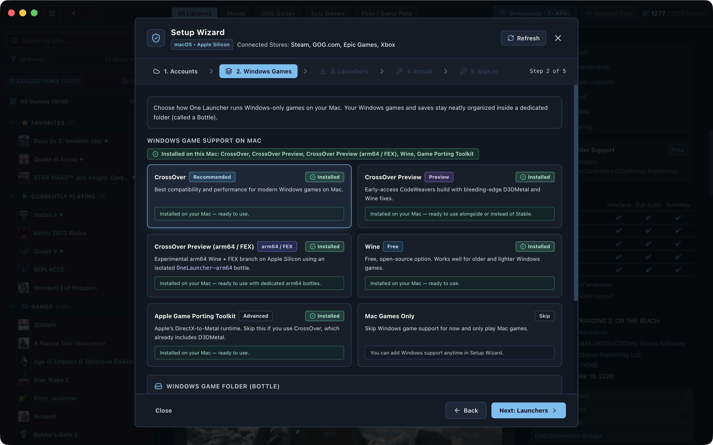
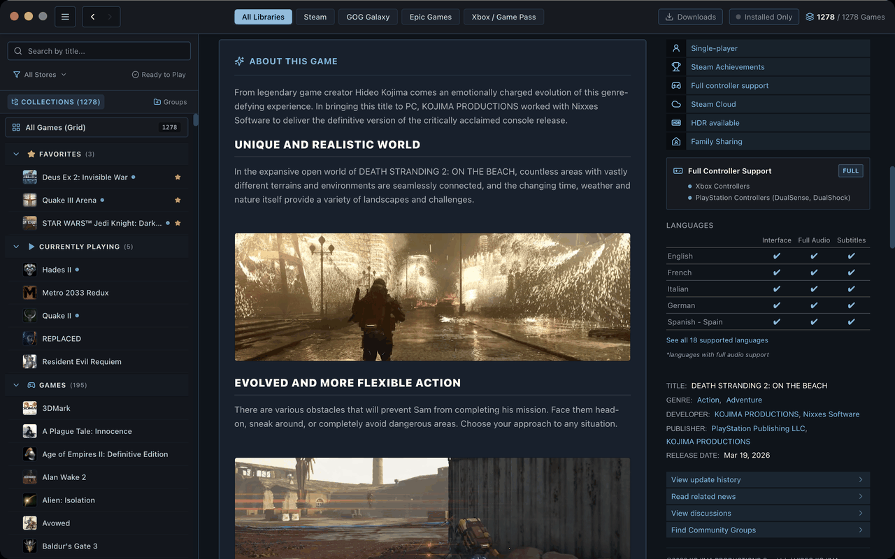
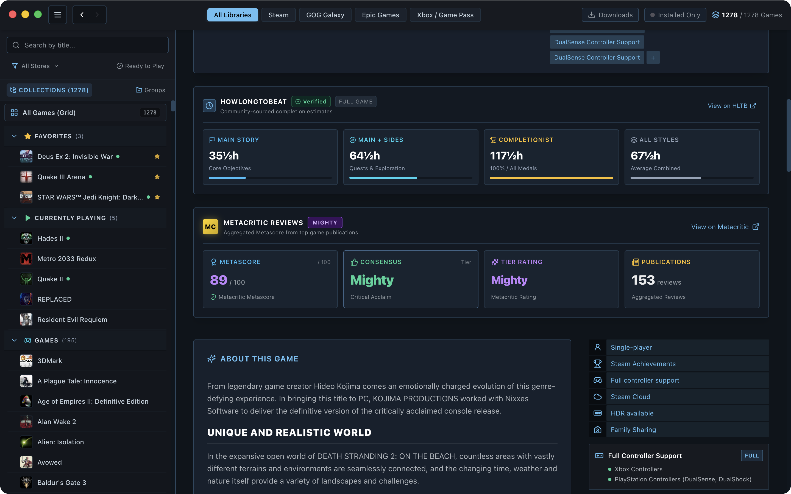
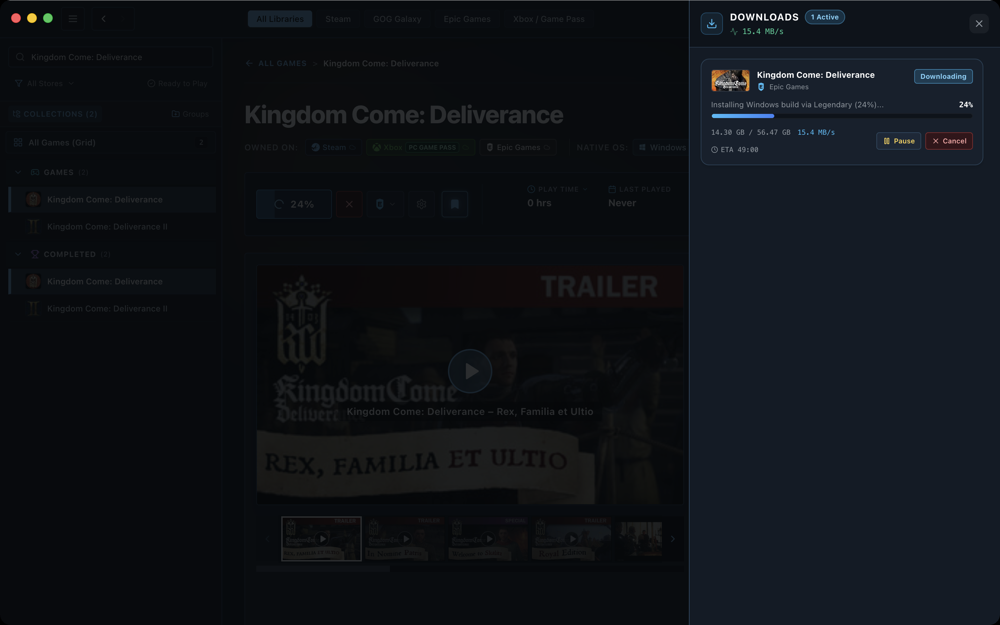
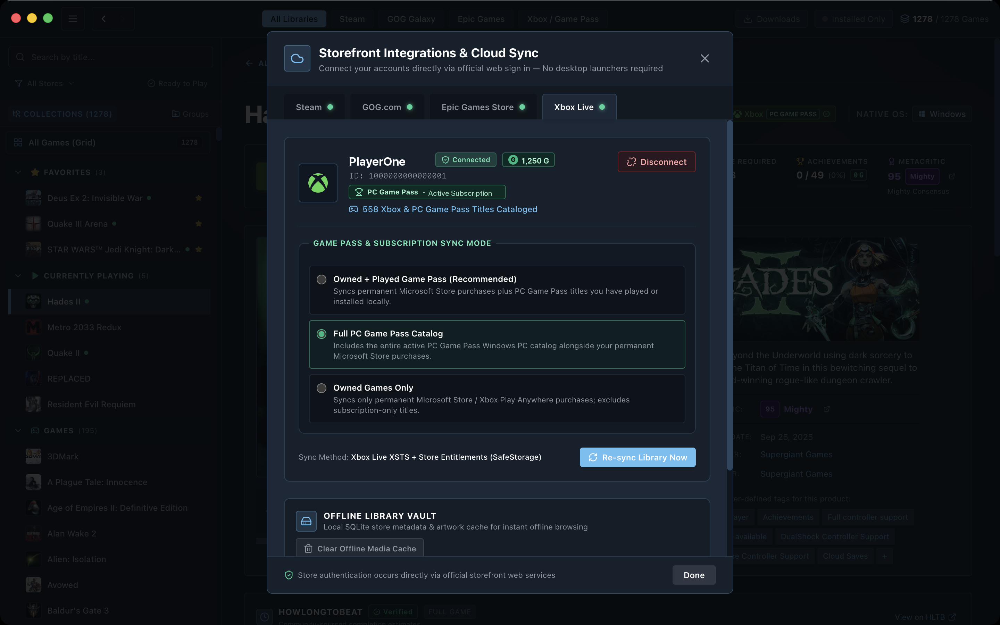
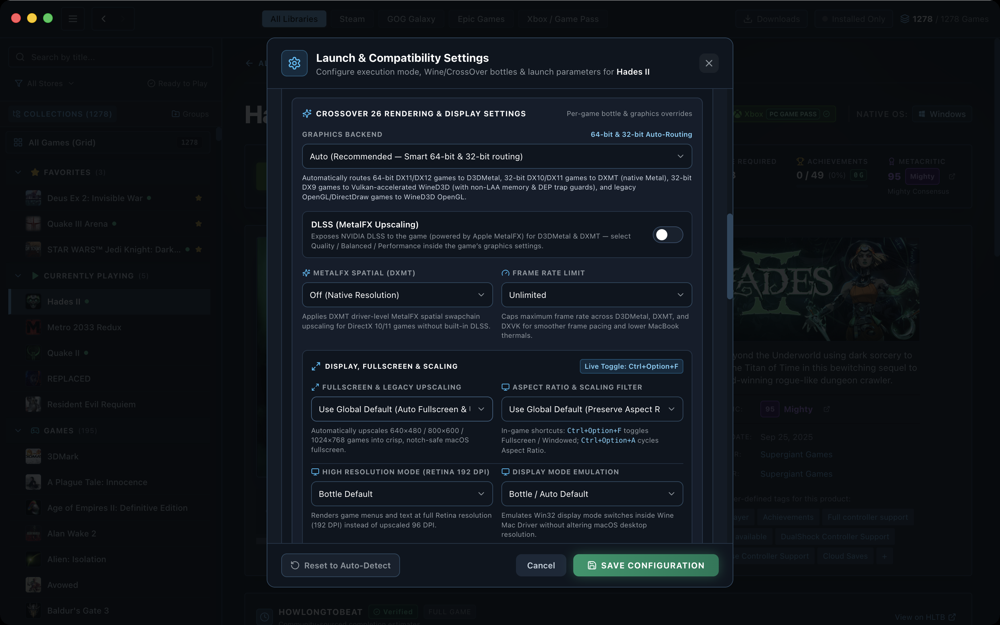
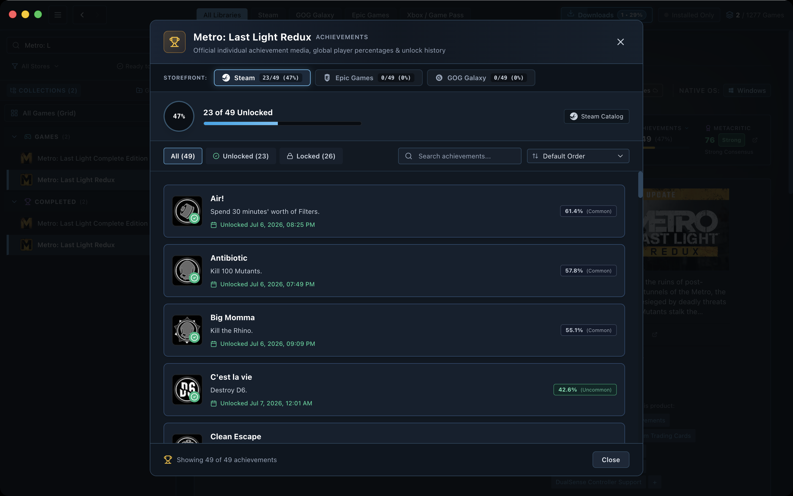

<div align="center">
  

  # One Launcher

  **Desktop game library and launcher for macOS and Windows.**

  [](https://github.com/Space-Cadet0/One-Launcher/releases/latest)
  [](#download--install)
  [](#download--install)
</div>

---

One Launcher is a desktop game library and launcher for **macOS (Apple Silicon)** and **Windows 10/11**. It puts your **Steam**, **GOG.com**, **Epic Games Store**, **Xbox / PC Game Pass**, and local games into one library where you can browse, organize, download, install, and launch them. On Mac, it also runs Windows games through CrossOver, Apple Game Porting Toolkit, or Wine.

---

## Download & Install

Download the latest installers from the **[Releases page](https://github.com/Space-Cadet0/One-Launcher/releases/latest)**. An in-app update check looks for newer GitHub releases and alerts you when an update is ready.

### macOS (Apple Silicon, macOS 13 or newer)
1. Download the macOS Apple Silicon `.dmg` installer from the [latest release](https://github.com/Space-Cadet0/One-Launcher/releases/latest).
2. Open the disk image and drag **One Launcher** into your **Applications** folder.
3. Because the app is not notarized with an Apple Developer subscription yet, macOS Gatekeeper may warn you on first launch. Right-click **One Launcher** in Applications and choose **Open**, or run this in Terminal:
   ```bash
   xattr -cr "/Applications/One Launcher.app"
   ```

### Windows (Windows 10 / 11, 64-bit)
- Download and run the Windows setup `.exe` installer from the [latest release](https://github.com/Space-Cadet0/One-Launcher/releases/latest).
- **One Launcher Full Uninstaller.exe** is attached to the same release if you want to remove the app completely.

### Setup Wizard


On first launch, a 5-step **Setup Wizard** walks through initial setup for your operating system:
- **macOS:** `1. Accounts` (connect Steam, GOG, Epic, and Xbox), `2. Windows Games` (choose a compatibility runner and bottle), `3. Launchers` (configure storefront clients), `4. Install` (automated setup), and `5. Sign In` (sign in to installed store clients).
- **Windows:** `1. System` (check Visual C++ Redistributable and WebView2 runtimes), `2. Accounts`, `3. Launchers`, `4. Install`, and `5. Sign In`.

After initial setup, **Setup Wizard** stays available in the top-left menu (and under **File -> Setup Wizard...** on Windows). If a tool, runtime, or bottle configuration needs attention later, an amber alert dot appears next to that menu item so you can reopen the wizard to check health or repair things.

---

## A Look Inside

### Your Library in One Place


View your catalog in a cover grid, filter by storefront or toggle **Installed Only** in the top bar, and sort by **Play Time**, **Rating**, **Recently Played**, **Release Year**, or **Alphabetical**. You can also filter across 6 categories: OS compatibility, critic or player rating, genres, game features (such as co-op or HDR), release year range, and developers or publishers.

### Organizing with Collections
Group games in the sidebar with 4 built-in collections (**Favorites**, **Currently Playing**, **Backlog**, and **Completed**) or create custom collections. You can pick from 24 color-coded icons, drag collections to reorder them in the sidebar, collapse or expand groups, and assign a game to multiple collections from its bookmark button or right-click menu.

### Game Details, Clips, and Reviews


Each game page shows playtime, last-played date, disk space, achievement progress, trailers, screenshots, and review scores. If you own the same game on multiple storefronts, One Launcher combines those copies into one game entry instead of listing duplicates.



Below the media gallery, the store description includes inline video clips, controller and DualSense support flags, supported languages (interface, audio, and subtitles), and system requirements.



**HowLongToBeat** cards list Main Story, Main + Sides, Completionist, and All Styles time estimates alongside **Metacritic**, **OpenCritic**, and **Steam** review breakdowns.

### Download, Install, and Launch by Storefront


For games owned on more than one store, the storefront switcher next to the main action button picks which store copy to manage, download, install, update, or launch. Clicking **Downloads** in the top bar opens the Downloads panel on the right with transfer speed, progress, ETA, and pause, resume, or cancel buttons. Active downloads pause automatically while a game is running and resume when you exit.

### Supported Storefronts and Account Sync


One Launcher connects directly to four storefronts, along with local game folders:
- **Steam:** Sign in with your Steam account or SteamID64 to import owned games, playtime, and achievements.
- **GOG.com:** Sign in directly to download DRM-free games and sync cloud saves without GOG Galaxy installed (optional GOG Galaxy support handles achievements and multiplayer).
- **Epic Games Store:** Sign in directly to download games, sync cloud saves, and track achievements without running the Epic Games Launcher for most titles.
- **Xbox / PC Game Pass:** Sign in with Microsoft / Xbox Live to import Microsoft Store purchases, Game Pass games, achievements, and cloud saves. Choose whether to sync the full Game Pass catalog, only games you have played or installed, or strictly owned purchases. **Chained launchers for Xbox Game Pass games (e.g., EA) are not yet implemented.**
- **Local and Standalone Installs:** Scans your drives and CrossOver or Wine bottles for macOS `.app` bundles and Windows `.exe` games while filtering out stray uninstallers and crash reporters. You can also link a local install manually using **Manage Game -> Locate Installed Game...** or set a custom executable in **Launch Settings...** (Windows) or **Launch & Compatibility Settings...** (macOS).

Sign-ins go directly to each storefront's official login page with no One Launcher account or external server in between, and tokens are encrypted in your operating system's keychain. Store metadata and artwork are cached locally in the **Offline Library Vault** (configurable at `250 MB`, `1 GB`, or `2 GB`) so your library stays browsable offline.

### Playing Windows Games on Mac


Windows game compatibility on Mac is intended for, and works best with, **[CrossOver](https://www.codeweavers.com/crossover)** (available to buy from the [CodeWeavers Store](https://www.codeweavers.com/store)). One Launcher also supports **CrossOver Preview** (Intel/win64 and Apple Silicon `arm64`/FEX builds), **Apple Game Porting Toolkit (GPTK)**, and open-source **Wine**, with per-game runner and bottle selection as well as install and update checks.

Each game keeps its own graphics, performance, and display settings:
- **Graphics backends:** Choose **Auto**, **D3DMetal** (with v4 and v3 selection on dual-D3DMetal CrossOver Preview builds), **DXMT**, **DXVK**, or **WineD3D**.
- **Upscaling and frame pacing:** Enable **MetalFX DLSS** (64-bit games on macOS Tahoe 26+ with D3DMetal, or macOS Sonoma 14+ with DXMT) or **MetalFX Spatial** (`1.33x` to `2.0x`), turn on **Apple Metal HUD** or **DXVK / DXMT HUD**, cap frame rates (`30` to `144` FPS or unlimited), choose **MSync** or **ESync** thread synchronization, and toggle the **32-bit 4 GB Address Space Override** for older 32-bit titles.
- **Display Scaler:** Many older Windows games only offer low fixed resolutions (such as `640x480`, `800x600`, or `1024x768`), or have trouble with MacBook Retina scaling, screen notches, and exclusive fullscreen. That often causes tiny corner windows, clipped or stretched menus, black screens, or a trapped cursor when switching apps. Without modifying game files on disk, One Launcher sits between the game's display calls and macOS using Display Mode Emulation and a lightweight fullscreen presenter. It reports standard display modes to the game and draws output into a single notch-safe macOS borderless window scaled to your display. You can pick **4:3 Pillarbox**, **Integer Pixel-Perfect**, or **Stretch** aspect modes, switch apps with cooperative `Cmd+Tab` (releasing the cursor and minimizing cleanly), toggle fullscreen (`Ctrl+Option+F`) or cycle aspect ratios (`Ctrl+Option+A`) while playing, and enable **Retina 192 DPI** mode for sharp text and menus.
- **Input and cleanup:** Configures controller compatibility (including clean-room Xbox GDK bridge DLLs), flags Windows kernel-level anti-cheat incompatibilities on the game page, and closes temporary storefront client wrappers when you exit a game (**Client Auto-Close**).

### Achievements Across Stores


View unlocked and locked achievements across **Steam**, **Epic Games Store**, **GOG.com**, and **Xbox** in one modal. For games owned on more than one store, tabs at the top switch between each storefront's unlock progress, timestamps, and global rarity percentages. Secret achievement descriptions stay hidden behind a **Reveal Spoiler** toggle.

### Automatic Game Matching and Manual Overrides


One Launcher automatically matches your store accounts and local folders to game metadata while filtering out tools, SDKs, dedicated servers, and redistributables. When a local folder or older install gets matched incorrectly, you can fix or override it using the 4-step **Fix Match & Metadata** wizard to search Steam, IGDB, GOG, Epic, and Xbox, replace cover art, choose a review source, or edit details. You can also audit unmatched installs, auto-filtered items, and manual overrides across your catalog in **Library Match & Overrides Studio**.

---

## Current Limitations

- **Chained launchers for Xbox Game Pass games (e.g., EA) are not yet implemented.** Direct Game Pass titles work normally, while Game Pass titles that hand off to a separate third-party publisher client like the EA App are not supported yet.
- Games that require Windows kernel-level anti-cheat (such as Riot Vanguard) cannot run through translation tools on macOS and require native Windows.

---

## Credits

- **Bundled storefront CLI tools:** [Legendary](https://github.com/legendary-gl/legendary) (originally by derrod, GPL-3.0) for Epic Games Store downloads, updates, launching, and cloud saves; [heroic-gogdl](https://github.com/Heroic-Games-Launcher/heroic-gogdl) (by the Heroic Games Launcher team, GPL-3.0) for GOG.com downloads, repairs, and cloud saves.
- **macOS compatibility and graphics layers (external tools integrated or provisioned by One Launcher):** [CrossOver](https://www.codeweavers.com/crossover) by CodeWeavers, Apple Game Porting Toolkit (`D3DMetal`) and Rosetta 2, [Wine](https://www.winehq.org/) (LGPL-2.1+), [Gcenx macOS Wine builds](https://github.com/Gcenx/macOS_Wine_builds) and [Gcenx GPTK](https://github.com/Gcenx/game-porting-toolkit), [DXMT](https://github.com/3Shain/dxmt) (LGPL-3.0), [DXVK](https://github.com/doitsujin/dxvk) (zlib), [MoltenVK](https://github.com/KhronosGroup/MoltenVK) (Apache-2.0), and WineD3D (LGPL-2.1+).
- **Metadata, artwork, and review sources:** [HowLongToBeat](https://howlongtobeat.com/), [OpenCritic](https://opencritic.com/), [Metacritic](https://www.metacritic.com/), [Lutris](https://lutris.net/), and [IGDB](https://www.igdb.com/), alongside Steam, GOG.com, Epic Games, and Xbox storefront APIs.
- **Desktop framework:** Built with [Electron](https://www.electronjs.org/) and [React](https://react.dev/).

---

<details>
<summary>Building from Source (For Developers)</summary>

Requires **Node.js 22+**, **npm**, and **Zig 0.13.0** (for building both the Xbox GDK bridge DLLs and the Display Scaler binaries from C source).

```bash
git clone https://github.com/Space-Cadet0/One-Launcher.git
cd One-Launcher

npm install
npm run build:xbox-bridge
npm run build:display-scaler
npm run build:macos-helpers   # macOS only

# Run renderer + Electron desktop shell in separate terminals
npm run dev
npm run desktop
```

To package release installers locally:
```bash
npm run dist:mac   # macOS arm64 DMG
npm run build:win  # Windows x64 installer & uninstaller
```

</details>

---

## License

Released under the [MIT License](LICENSE).
