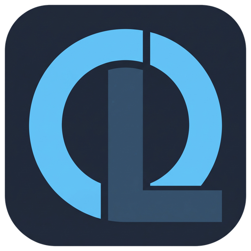
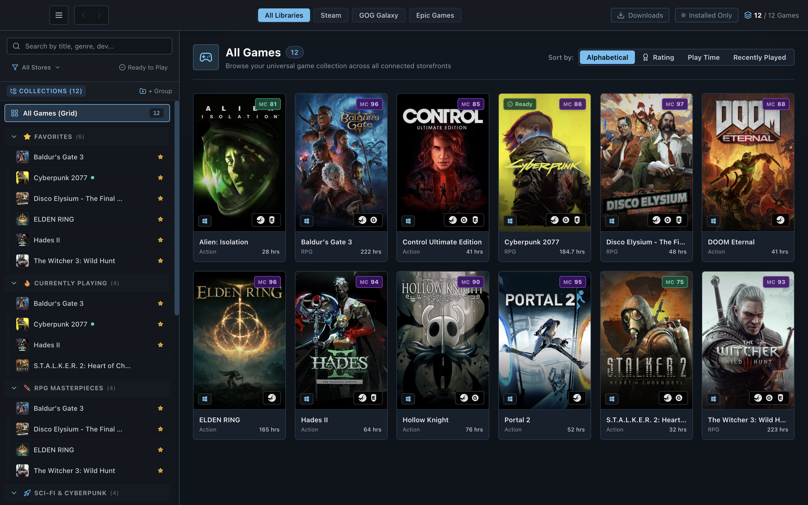
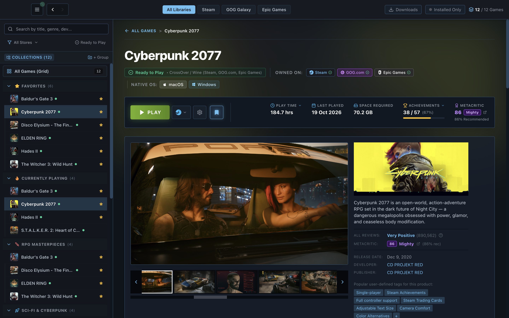
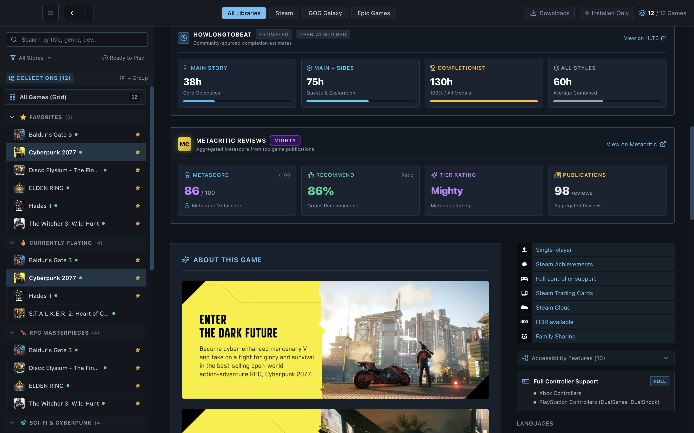
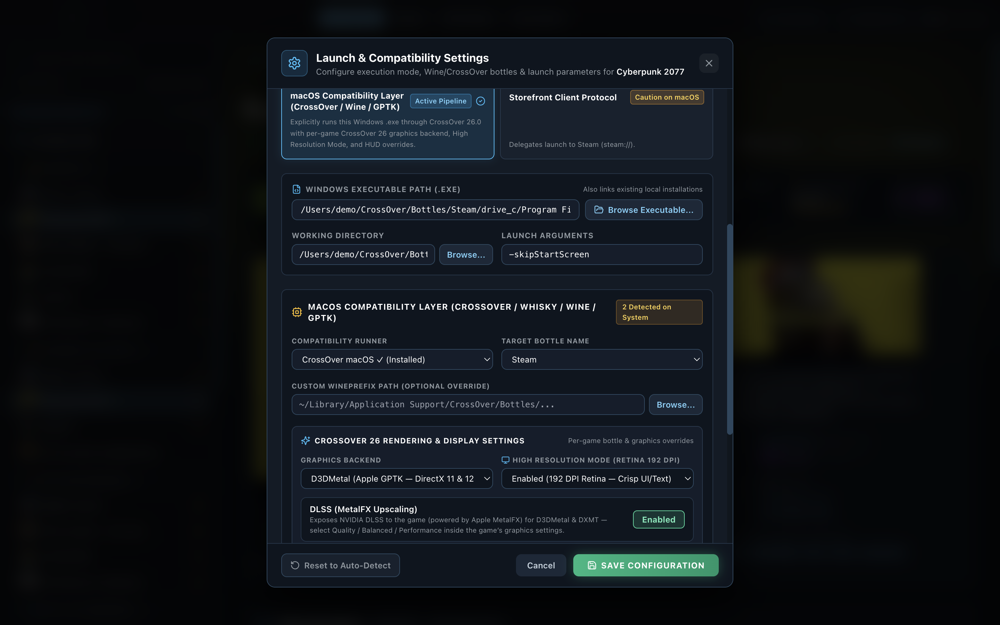
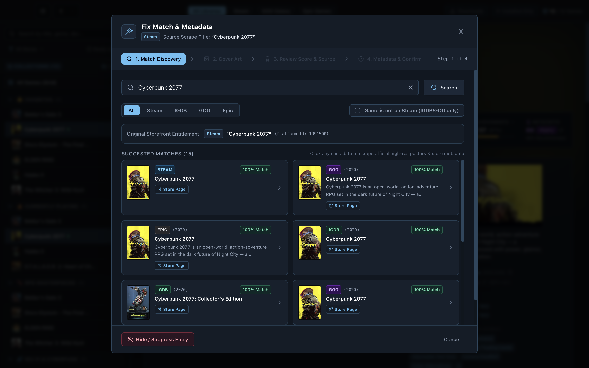
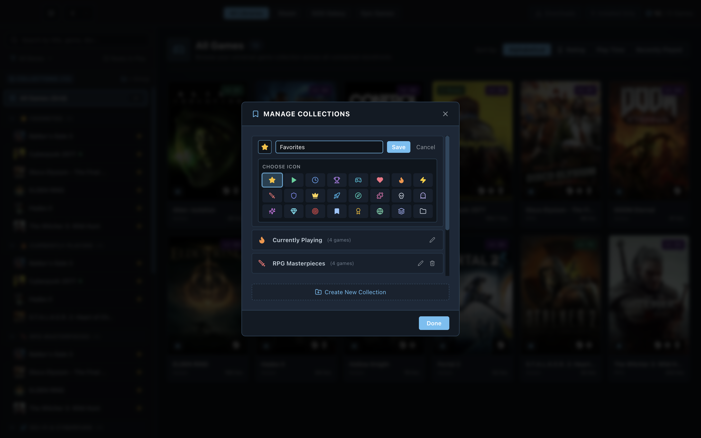

<div align="center">
  

  # One Launcher

  **Your Unified PC & Mac Game Library — Steam, GOG, Epic Games & Local Installations in One Native Desktop App**

  [-000000?style=for-the-badge&logo=apple&logoColor=white)](#installation--quick-start)
  [-0078D6?style=for-the-badge&logo=windows&logoColor=white)](#installation--quick-start)
  [](#2-first-class-macos--crossover-26-compatibility-engine)
  [](#1-unified-multi-storefront-library)
</div>

---

**One Launcher** brings all of your PC and Mac games together into a single, fast, cinema-grade desktop application. Whether your library lives across **Steam**, **GOG.com**, **Epic Games Store**, standalone local folders, or **Windows `.exe` games running on macOS via CrossOver 26, Whisky, Wine, Heroic, or Apple Game Porting Toolkit (GPTK)**, One Launcher unifies your collection with automatic artwork, Metacritic & OpenCritic ratings, HowLongToBeat completion times, unified achievement tracking, and one-click launching.

---

## Visual Showcase

### Unified Library Grid & Custom Collections

*Browse your entire collection across Steam, GOG, and Epic Games in a high-density vertical box-art grid with live Metacritic/OpenCritic badges, multi-storefront ownership indicators, instant punctuation-tolerant search, and custom sidebar collections.*

### Rich Game Detail View & Multi-Storefront Switcher

*Inspect high-resolution screenshot galleries and trailers, playtime, achievement mastery progress, active CrossOver/Wine compatibility pipeline status, and switch between owned storefront editions (`Steam`, `GOG.com`, `Epic Games`) right next to the **PLAY** button.*


*Scroll down on any game page for **HowLongToBeat** completion estimates (Main Story, Main + Sides, Completionist, All Styles), **Metacritic & OpenCritic** review consensus cards, rich HTML **About This Game** descriptions with inline media, **System Requirements**, storefront capability badges, and accurate 3-column **Supported Languages** matrices (`Interface`, `Full Audio`, `Subtitles`).*

### CrossOver 26 & macOS Compatibility Launch Settings

*Configure per-game and per-storefront launch profiles. Automatically detects Windows `.exe` installations inside CrossOver, Whisky, Wine, or GPTK bottles and gives you per-game controls for Graphics Backend (`Auto`, `D3DMetal`, `DXMT`, `DXVK`, `WineD3D`), High Resolution Mode (Retina 192 DPI), DLSS (MetalFX Upscaling), MSync / ESync, and Metal / DXVK HUD overlays.*

### 4-Step Fix Match & Metadata Override Studio

*Need to re-match a local folder or customize a game's artwork? The 4-step Match & Metadata Wizard searches Steam, GOG, Epic Games, and IGDB simultaneously, lets you cherry-pick capsule art, hero banners, and descriptions, and previews your changes live before saving.*

### Custom Collections & 24-Icon Library Organizer

*Organize your library into custom shelves and collections with 24 selectable icons, pin your favorites, and manage bulk artwork & metadata across your entire catalog.*

---

## Key Features (End-User Guide)

### 1. Unified Multi-Storefront Library
Stop juggling multiple launchers to remember where you own or installed a game:
- **Steam Integration**: Sign in via Steam OpenID or connect your public Steam profile, and automatically scan local `libraryfolders.vdf` & `appmanifest_*.acf` files across internal and external drives—including Steam installs inside CrossOver and Wine bottles.
- **GOG.com Integration**: Connect via official GOG OAuth to import your cloud library, scan local GOG Galaxy databases, and automatically detect standalone offline GOG installers.
- **Epic Games Store Integration**: Connect via Epic OAuth (`authorization_code` or seamless browser sign-in) and automatically detect local Epic Games Launcher, Heroic Games Launcher, and Legendary manifests.
- **Automatic Multi-Storefront Deduplication**: Own the same title on Steam, GOG, and Epic? One Launcher merges them into a single unified entry displaying all owned storefront badges, combined playtime, and a per-storefront installation switcher right next to the **PLAY** button.

### 2. First-Class macOS & CrossOver 26 Compatibility Engine
Built from the ground up for Mac gamers running both native Apple Silicon titles and Windows games:
- **Automatic Bottle & `.exe` Discovery**: Scans CrossOver (`~/Library/Application Support/CrossOver/Bottles`), Whisky, Wine prefixes, Heroic, and custom directories to find installed Windows games automatically.
- **Smart Storefront-in-Bottle Routing**: If a Windows game is installed via a Windows Steam, GOG Galaxy, or Epic Games client inside a CrossOver bottle, One Launcher automatically routes execution through the bottle's storefront client or direct `.exe` without erroneously triggering native macOS `steam://` or `com.epicgames.launcher://` URL schemes.
- **Per-Game & Per-Storefront Launch Profiles**: Configure distinct executables, working directories, launch arguments, and compatibility runners for each storefront edition of a game (`Steam`, `GOG.com`, `Epic Games`).
- **CrossOver 26 Rendering & Display Controls**:
  - **Graphics Backend**: Choose `Auto`, `D3DMetal` (Apple GPTK DirectX 11/12), `DXMT` (Metal-based DirectX 11), `DXVK` (Vulkan/MoltenVK), or `WineD3D` (OpenGL).
  - **High Resolution Mode (Retina 192 DPI)**: Toggle crisp Retina UI and text rendering per bottle.
  - **DLSS (MetalFX Upscaling)**: Expose NVIDIA DLSS powered by Apple MetalFX for supported D3DMetal & DXMT titles.
  - **Synchronization & Performance Overlays**: Toggle **MSync**, **ESync**, **Apple Metal HUD** (`MTL_HUD_ENABLED=1`), and **DXVK HUD** (`DXVK_HUD=fps,devinfo`) per game.

### 3. Rich Metadata, Critic Scores & HowLongToBeat
Every game in your library is automatically enriched with:
- **High-Resolution Artwork**: Vertical 2:3 library capsules, widescreen hero headers, HD logos, screenshot galleries, and video trailers.
- **Metacritic & OpenCritic Scores**: Live critic score badges (`Mighty`, `Strong`, `Fair`, `Weak`) with percentage recommended and review counts, plus one-click sorting by critic rating.
- **HowLongToBeat Estimates**: Accurate completion times broken down by **Main Story**, **Main + Extras**, and **Completionist** playstyles.
- **Accurate Multi-Tier Supported Languages**: Full language support breakdown across **Interface**, **Full Audio**, and **Subtitles**, parsed directly from storefront localization tables and structured Steam HTML matrices.

### 4. Unified Achievements & Mastery Tracking
- **Interactive Achievements Modal**: Inspect every unlocked and locked achievement for your games, complete with high-resolution icons, unlock timestamps, and global player rarity percentages.
- **Spoiler Protection**: Hidden/secret achievement descriptions are blurred until you click to reveal them.
- **Mastery Badges**: Games where you've unlocked 100% of achievements earn a golden **Mastered** crown across your library and detail views.
- **Loose & Punctuation-Tolerant Search**: Quickly filter long achievement lists by title or description without worrying about punctuation or casing.

### 5. Custom Collections & Punctuation-Tolerant Instant Search
- **24-Icon Custom Collections**: Create unlimited custom groups (e.g., *Favorites*, *Currently Playing*, *RPG Masterpieces*, *Mac Native Gems*, *Sci-Fi & Cyberpunk*, *Completed 100%*) and personalize each shelf with 24 crisp vector icons (`star`, `flame`, `sword`, `shield`, `gamepad`, `trophy`, `crown`, `rocket`, `apple`, `monitor`, and more).
- **Punctuation-Tolerant Instant Search**: Find any game immediately regardless of colons, apostrophes, periods, or hyphens:
  - Type `alien isolation` to match **Alien: Isolation**
  - Type `deaths door` to match **Death's Door**
  - Type `stalker 2` to match **S.T.A.L.K.E.R. 2: Heart of Chornobyl**
  - Type `spiderman` to match **Marvel's Spider-Man Remastered**

### 6. 4-Step Fix Match & Metadata Override Studio
If a local game folder has an ambiguous name or you want custom box art:
1. **Step 1 — Search & Identify**: Search across Steam, GOG, Epic Games, and IGDB simultaneously with punctuation-tolerant matching.
2. **Step 2 — Artwork Selection**: Pick your preferred vertical cover art, hero banner, and logo from any matched provider or provide a custom image URL/local file.
3. **Step 3 — Metadata & Details**: Customize the title, developer, publisher, release date, genres, and summary description.
4. **Step 4 — Live Preview & Save**: Preview exactly how your game card and detail page will look before applying the override.

---

## Installation & Quick Start

### Option A: Download Pre-Built Desktop App
1. **macOS (Apple Silicon — macOS 13.0+)**:
   - Download the latest `One Launcher-<version>-arm64.dmg` from the **Releases** page.
   - Open the `.dmg` and drag **One Launcher.app** into your `/Applications` folder.
   - On first launch, if macOS Gatekeeper prompts that the app is from an unidentified developer, right-click **One Launcher.app** -> **Open**, or run:
     ```bash
     xattr -cr "/Applications/One Launcher.app"
     ```
2. **Windows (Windows 10 / 11 x64)**:
   - Download and run the latest `One Launcher Setup <version>.exe` installer or portable executable from the **Releases** page.

### Option B: Build & Run from Source
Prerequisites: **Node.js 20+** and **npm**.

```bash
# 1. Clone the repository
git clone https://github.com/Space-Cadet0/One-Launcher.git
cd One-Launcher

# 2. Install dependencies
npm install

# 3. Launch in desktop development mode (Vite + Electron)
npm run electron:dev
```

To package a production desktop installer for your platform:
```bash
# Build native macOS Apple Silicon (.app and .dmg in release/)
npm run build:mac

# Build Windows installer (.exe in release/)
npm run build:win
```

---

## Quick Start Guide: Setting Up Your Library

### 1. Connect Your Storefronts
1. Click the **Settings / Integrations** button (or open **Storefront Connections** from the top navigation bar).
2. **Steam**: Click **Sign in with Steam** (or enter your Steam ID / vanity URL) to sync your owned games, playtime, and achievements. Local Steam libraries—including Steam installs inside CrossOver bottles—are detected automatically.
3. **GOG.com**: Click **Connect GOG Account** and sign in through the official GOG window to import your GOG library, or let One Launcher scan your local GOG Galaxy database.
4. **Epic Games**: Click **Connect Epic Games** to sign in with your Epic account, or paste an authorization code if using an external browser.

### 2. Import Local Games or CrossOver Bottles
1. Open **Settings -> Local Folders & Compatibility Bottles**.
2. Add any directory containing native macOS `.app` bundles, Windows `.exe` games, or CrossOver / Whisky / Wine bottles.
3. One Launcher will automatically filter out uninstallers, crash reporters, and redistributables (`UnityCrashHandler64.exe`, `vc_redist.x64.exe`, `DXSETUP.exe`), match your games against Steam/GOG/Epic/IGDB, and populate full artwork and metadata.

### 3. Configure Per-Game Launch & CrossOver 26 Settings
1. Open any game in your library and click the **Gear (`⚙`) -> Launch & Compatibility Settings** button next to **PLAY**.
2. If you own or installed the game on multiple storefronts (e.g., Steam and GOG), select the **Storefront Installation Profile** pill at the top of the modal to configure each installation independently.
3. Choose **Auto-Detect (Recommended)**, **Direct Executable**, **macOS Compatibility Layer (CrossOver / Wine / GPTK)**, or **Storefront Client Protocol**.
4. For Windows games on macOS, select your target **CrossOver Bottle**, choose your **Graphics Backend** (`D3DMetal`, `DXMT`, `DXVK`, or `WineD3D`), and toggle **High Resolution Mode (Retina 192 DPI)**, **DLSS (MetalFX Upscaling)**, **MSync**, or **Metal HUD**, then click **Save Configuration**.

---

## Privacy & Local-First Architecture

- **Zero Telemetry & No Third-Party Cloud Accounts**: All of your library catalogs, custom collections, metadata overrides, and authentication tokens are stored locally on your machine.
- **Read-Only Storefront Discovery**: One Launcher reads local storefront manifests (`libraryfolders.vdf`, GOG Galaxy DB, Epic `.item` manifests) non-destructively and never modifies your storefront client installations.

---

## License

Released under the [MIT License](LICENSE).
