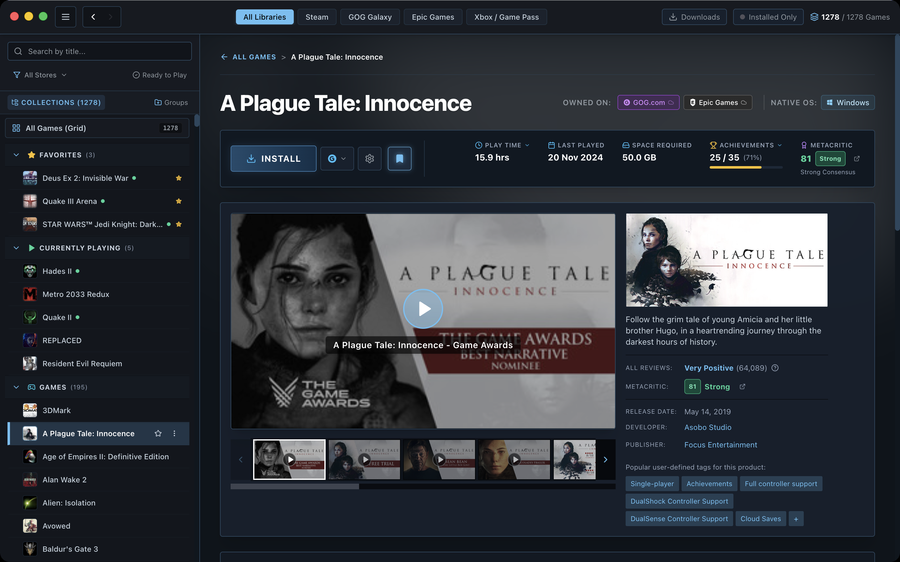

<div align="center">
  

  # One Launcher

  **All of your PC and Mac games in one place — Steam, GOG, Epic Games, Xbox / PC Game Pass, and local installs.**

  [](https://github.com/Space-Cadet0/One-Launcher/releases/tag/v0.2.7)
  [](#download--install)
  [](#download--install)
</div>

---

If your games are split across Steam, GOG, Epic, Xbox / PC Game Pass, and a handful of standalone folders, it gets annoying fast trying to remember where you own something or which launcher actually has it installed.

One Launcher pulls your whole collection into a single desktop app for **macOS (Apple Silicon)** and **Windows 10/11**. It tracks what you own, merges duplicates across stores, and pulls in artwork, critic scores, and HowLongToBeat times. You can launch Mac-native games, Windows games on PC, or Windows games on Mac via CrossOver, Apple Game Porting Toolkit, or Wine.

---

## Download & Install

Grab the latest installers from the **[v0.2.7 Release page](https://github.com/Space-Cadet0/One-Launcher/releases/tag/v0.2.7)**.

### macOS (Apple Silicon, macOS 13 or newer)
1. Download **`One Launcher-0.2.7-arm64.dmg`** from the [v0.2.7 release](https://github.com/Space-Cadet0/One-Launcher/releases/tag/v0.2.7).
2. Open the disk image and drag **One Launcher** into your **Applications** folder.
3. Because the app isn't notarized with an Apple Developer subscription yet, macOS Gatekeeper may warn you on first launch. Right-click **One Launcher** in Applications and choose **Open**, or run this in Terminal:
   ```bash
   xattr -cr "/Applications/One Launcher.app"
   ```

### Windows (Windows 10 / 11, 64-bit)
- Download and run **`One Launcher Setup 0.2.7.exe`** from the [v0.2.7 release](https://github.com/Space-Cadet0/One-Launcher/releases/tag/v0.2.7).
- If you ever want a clean removal later, **`One Launcher Full Uninstaller.exe`** is also attached to the same release.

When you open One Launcher for the first time, a 5-step Setup Wizard walks you through signing in to your store accounts and checking your Mac compatibility tools (like CrossOver or Wine) or Windows prerequisites. You can re-open it anytime from the top-left menu.

---

## A Look Inside

### Your whole library on one screen

Filter by storefront, readiness, genre, critic score, or release era, and organize your games into custom collections in the sidebar.

### Game pages with storefront switching

Each game gets its own page with trailers, screenshots, playtime, Metacritic/OpenCritic scores, and HowLongToBeat estimates. If you own the same title in more than one place, One Launcher combines them into a single page and puts a store picker right next to the Play or Install button.

### Store accounts, Game Pass sync modes, and offline caching

Sign in directly to Steam, GOG.com, Epic Games, and Xbox Live through their official login pages, without leaving extra store apps running in the background. For Xbox / PC Game Pass, you can choose whether to show your full Game Pass catalog, only games you've played or installed, or just permanent purchases.

### Playing Windows games on Mac

If you play Windows games on a Mac, each title gets its own menu for graphics and display tweaks: turn on MetalFX upscaling, cap frame rates to keep fans quiet, enable Retina resolution, and adjust fullscreen or aspect-ratio scaling without leaving the game.

### Achievements across stores

Browse unlocked and locked achievements with global rarity percentages and unlock dates. Descriptions for secret achievements stay blurred until you click them, so you won't accidentally spoil a story beat.

---

## What It Does

### Connects your storefronts without getting in the way
One Launcher brings together **Steam**, **GOG.com**, **Epic Games Store**, **Xbox / PC Game Pass**, and **local installs** (both Mac `.app` bundles and Windows `.exe` folders). It scans your drives and CrossOver or Wine bottles for games you already installed, skipping stray uninstallers and crash reporters. If you own the same game on two stores, it merges them into a single entry.

*Note on Xbox Game Pass:* Direct Xbox and PC Game Pass games are supported on both Windows and Mac, including achievements and cloud saves. However, **chained launchers for Xbox Game Pass games (such as EA games launched through the EA App) are not yet implemented.**

### Makes Windows games behave better on Mac
On Apple Silicon Macs, One Launcher detects your installed **CrossOver**, **CrossOver Preview** (Intel and ARM modes), **Apple Game Porting Toolkit**, and **Wine** setups automatically. You can pick the graphics mode per game (`D3DMetal`, `DXMT`, `DXVK`, or `WineD3D`) and enable MetalFX DLSS upscaling where supported. Older Windows games that normally break or stretch on modern Mac screens get automatic fullscreen fixes too. While playing, press `Ctrl+Option+F` to flip between fullscreen and windowed, or `Ctrl+Option+A` to cycle aspect ratios like 4:3.

### Keeps downloads, saves, and offline browsing tidy
You can queue downloads right from the app and have them pause automatically the second you launch a game. Before and after each session, One Launcher saves rolling local backups of your save files alongside your store's cloud sync. When you're in-game, **In-Game Hibernation** drops artwork and video memory so the launcher stays lightweight, and the **Offline Library Vault** keeps your game list and covers cached for flights or spotty Wi-Fi.

### Fixes messy matches when local folders look weird
If a DRM-free folder or old installer gets misidentified, **Fix Match** searches Steam, GOG, Epic, and IGDB at once to track it down. You can swap the cover or hero art, edit the title, and preview the card before saving.

---

## Good to Know (Current Limitations)

- **Chained launchers for Xbox Game Pass games (e.g., EA) are not yet implemented.** Direct Game Pass titles work, while Game Pass games that hand off to a third-party publisher client like the EA App aren't supported yet.
- Games that require Windows kernel-level anti-cheat (such as Riot Vanguard) cannot run on a Mac through compatibility tools and require native Windows.

---

<details>
<summary>Building from Source (For Developers)</summary>

Requires **Node.js 22+**, **npm**, and **Zig 0.13.0** (for building the Xbox GDK bridge DLLs from C source).

```bash
git clone https://github.com/Space-Cadet0/One-Launcher.git
cd One-Launcher

npm install
npm run build:xbox-bridge
npm run build:display-scaler
npm run build:macos-helpers   # macOS only

# Run renderer + Electron desktop shell in separate terminals
npm run dev
npm run desktop
```

To package release installers locally:
```bash
npm run dist:mac   # macOS arm64 DMG
npm run build:win  # Windows x64 installer & uninstaller
```

</details>

---

## License

Released under the [MIT License](LICENSE).
